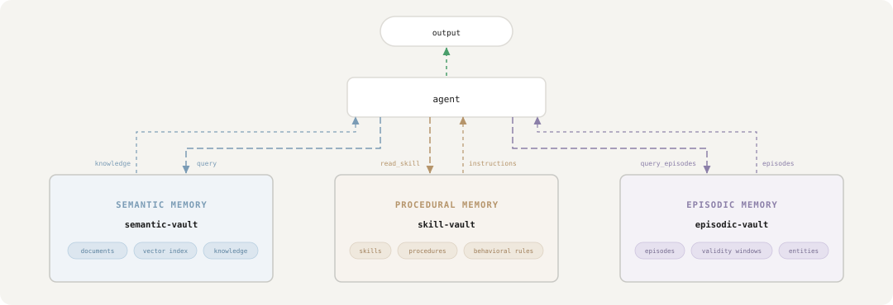
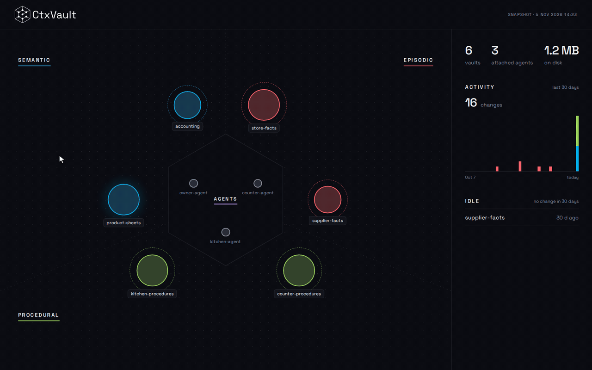

<div align="center">
<picture>
    <source media="(prefers-color-scheme: dark)" srcset="https://raw.githubusercontent.com/Filippo-Venturini/ctxvault/main/assets/logo_white_text.svg" width="400" height="100">
    <source media="(prefers-color-scheme: light)" srcset="https://raw.githubusercontent.com/Filippo-Venturini/ctxvault/main/assets/logo_black_text.svg" width="400" height="100">
    
</picture>

<h3>Local memory infrastructure for AI agents</h3>
<p><i>Isolated vaults. Typed memory. Agent-autonomous. Human-observable.</i></p>

[](https://opensource.org/licenses/MIT)
[](https://pypi.org/project/ctxvault/)


[Live demo](https://filippo-venturini.github.io/ctxvault/demo.html) • [Docs](https://filippo-venturini.github.io/ctxvault/) • [Quick Start](#quick-start) • [Examples](#examples) • [Roadmap](#roadmap) • [Contributing](#contributing)

</div>

<!-- mcp-name: io.github.Filippo-Venturini/ctxvault -->

---

## What is CtxVault?

Most agent frameworks treat memory as an afterthought: a shared vector store where isolation depends on configuration staying correct and everything, facts and procedures alike, gets embedded into the same undifferentiated index. The agent cannot tell what it knows from how it should act.

CtxVault is built around a different primitive. Memory is organized into **vaults**: self-contained, directory-backed units with explicit types, one for each kind of memory an agent has. Isolation is structural, the topology is defined explicitly (one vault per agent, a shared knowledge base, private skills for a specific role, or any combination), with access control that determines exactly which agents can reach which vault.

The result is a memory layer that behaves like real infrastructure: typed, composable, observable, persistent and entirely local.

<div align="center">
  
</div>

---

## Core Principles

### Typed memory: semantic, procedural and episodic

Classical cognitive architectures, from [ACT-R (Anderson et al., 2004)](https://en.wikipedia.org/wiki/ACT-R) to [CoALA (Sumers et al., 2024)](https://arxiv.org/abs/2309.02427), separate an agent's long-term memory into distinct modules: what it knows, how it acts, and what happened. Most agent frameworks ignore the distinction and store everything in a single vector index. In CtxVault each kind of memory is a vault type:

| Vault | Memory | What it holds | How the agent reads it |
|-------|--------|---------------|------------------------|
| **Semantic** | Semantic: *what* the agent knows | Documents (PDF, DOCX, MD, TXT), chunked and embedded into a local vector index | By meaning: a query returns the closest chunks, with their source |
| **Skill** | Procedural: *how* the agent acts | Procedures in markdown, each with a name and a description | By name: the agent lists the skills and reads the one it needs |
| **Episodic** | Episodic: *when* something was true | Statements with two timelines: when they hold in the world, and when the vault learned it | By entity, validity and source, as of today or any past instant |

All three types share the same primitives: public or restricted, local or global, composable in any topology. [How each type works →](https://filippo-venturini.github.io/ctxvault/how-it-works/memory-types/)

<div align="center">
  
</div>

### Structural isolation and access control

Isolation enforced through prompt logic or metadata schemas is fragile: it grows harder to reason about as systems scale, and fails silently when it breaks.

In CtxVault, each vault is an independent index. Agents have no shared retrieval path unless one is explicitly defined. Vaults can be declared restricted, with access granted to specific agents directly through the CLI. The boundary is part of the architecture, not a rule written in a config file that someone might later get wrong.

```
Found 3 vaults

> agent-a-vault [RESTRICTED]
  path:    ~/.ctxvault/vaults/agent-a-vault
  agents:  agent-a

> shared-vault [PUBLIC]
  path:    ~/.ctxvault/vaults/shared-vault

> agent-c-vault [RESTRICTED]
  path:    ~/.ctxvault/vaults/agent-c-vault
  agents:  agent-c
```

### Persistent memory across sessions

Agents lose all context when a session ends. CtxVault gives them a knowledge base that persists across conversations, queryable by meaning rather than exact match. Context written in one session is retrievable days later using semantically related language.

<div align="center">
  
  <p><sub>Persistent memory across sessions, shown with Claude Desktop, works with any MCP-compatible client.</sub></p>
</div>

### Observable and human-controllable

When agents write to memory autonomously, visibility into what they write is not a debugging feature: it is the foundation of a trustworthy system. Whatever an agent wrote, through any interface, you can look at it three ways, and add to it yourself.

**On disk.** Every vault is a plain directory on your machine, readable and editable with any tool. Drop a document into a semantic vault or a skill into a skill vault, index it, and the agent sees it next to what it wrote on its own.

```
.ctxvault/
├── config.json              # the registry: every vault, its type, who can reach it
└── vaults/
    ├── product-sheets/      # semantic: your documents, and the chroma/ index
    ├── counter-procedures/  # skill: one markdown file per skill
    └── store-facts/         # episodic: episodes.db, a SQLite file
```

**From the CLI.** The same vaults, queried directly, independent of what any agent is doing.

```bash
ctxvault docs my-vault                                   # what the agent has written
ctxvault query my-vault "what decisions were made last week?"
ctxvault index my-vault                                  # add your own documents
ctxvault episodes my-vault --all                         # an episodic vault's statements
```

**In the browser.** `ctxvault ui` opens the memory viewer: a map of every vault, its type and the agents that can reach it, and a page per vault. Semantic documents show their chunks as the agent receives them, skills are rendered from their markdown, and an episodic vault has a time cursor that rewinds it to any past day. It is read-only and entirely local, and `--export` writes it to one self-contained HTML file. Try the [live demo](https://filippo-venturini.github.io/ctxvault/demo.html), no install needed: the bakery of [example 07](https://github.com/Filippo-Venturini/ctxvault/tree/main/examples/07-full-memory-topology/), three agents, six vaults, a year of facts.

<div align="center">
  <a href="https://filippo-venturini.github.io/ctxvault/demo.html">
    
  </a>
  <p><sub>The map of the live demo: three memory types, three agents, and what each agent can reach.</sub></p>
</div>

### Local-first

No cloud, no telemetry, no external services. Vaults are plain directories on your machine, the storage layer is entirely local. What you connect to that knowledge base is your choice.

---

## Integration Modes

CtxVault exposes the same vault layer through four interfaces. Use whichever fits your context, or combine them freely.

**[Python client](https://filippo-venturini.github.io/ctxvault/connect/python/)**: In-process. Import `Client`, open a vault by name and call it directly, with no server to start: for scripts, tests, pipelines and agents that own their memory.

**CLI**: Human-facing. Monitor vaults, inspect agent-written content, add your own documents, query knowledge bases directly.

**[HTTP API](https://filippo-venturini.github.io/ctxvault/connect/http/)**: Programmatic integration. Connect LangChain, LangGraph, or any custom pipeline to vaults via REST. Full CRUD, semantic search, and agent write support.

**[MCP server](https://filippo-venturini.github.io/ctxvault/connect/mcp/)**: For autonomous agents. Give any MCP-compatible client direct vault access with no integration code required. The agent handles `list_vaults`, `query`, `write_doc`, and `list_docs` on its own, and on an episodic vault it records and corrects facts with `write_episode`, `query_episodes`, `supersede_episode` and `invalidate_episode`, counts repetitions with `confirm_episode`, holds contradictions open with `dispute_episodes`, and discovers what the vault is about with `list_entities`.

Whichever door wrote it, `ctxvault ui` shows it: the viewer reads the same vaults, so what an agent recorded over MCP is on the page next to what you indexed from the CLI.

---

## CtxVault vs Alternatives

| | CtxVault | Chroma + your code | LangChain Memory | Mem0 | Graphiti (Zep) |
|--|----------|--------------------|------------------|------|----------------|
| Runs without cloud services | ✓ | ✓ | ✓ | self-hosted | self-hosted, plus a graph database |
| MCP server | ✓ | you build it | ✗ | ✓ | ✓ |
| Automatic fact extraction from conversations | ✗ (the agent decides what to write) | you build it | ✗ | ✓ | ✓ |
| Distinct memory types (semantic, procedural, episodic) | ✓ | you build it | ✗ | ✗ | ✗ |
| Bi-temporal facts (valid time and transaction time) | ✓ | you build it | ✗ | partial | ✓ |
| Graph-structured memory (entities and relations) | ✗ (planned) | you build it | ✗ | ✓ | ✓ |
| Per-agent access control | ✓ | you build it | ✗ | ✗ | ✗ |
| Storage as plain files on disk | ✓ | ✓ | ✗ | ✗ | ✗ (graph database) |
| Inspection UI | local | ✗ | ✗ | hosted | ✗ |

The ✗ in the CtxVault column are real: there is no graph layer and it does not extract facts for you. The ✓ are what it was built for: memory types, time, access control, and storage you can open as a folder.

---

## Examples

Seven scenarios, each with full code and setup instructions.

<!-- --8<-- [start:examples] -->
| # | Example | What it shows |
|---|---------|---------------|
| 01 | [**Single-Vault RAG**](https://github.com/Filippo-Venturini/ctxvault/tree/main/examples/01-simple-rag/) | Single vault, single agent. Semantic RAG over PDF, MD, TXT, DOCX with source attribution. ~100 lines. |
| 02 | [**Multi-Agent Isolation**](https://github.com/Filippo-Venturini/ctxvault/tree/main/examples/02-multi-agent-isolation/) | Two agents, two vaults. Each agent has no retrieval path to the other's vault: isolation enforced at the infrastructure layer, not through metadata filtering. ~200 lines. |
| 03 | [**Persistent Memory**](https://github.com/Filippo-Venturini/ctxvault/tree/main/examples/03-persistent-memory/) | An agent that recalls context across sessions using semantic queries. "financial constraints" retrieves "cut cloud costs by 15%" written three days prior. |
| 04 | [**Access Control**](https://github.com/Filippo-Venturini/ctxvault/tree/main/examples/04-composed-topology/) | Three agents, five vaults: private, shared between a subset, and public. A tiered support system where access boundaries reflect organizational boundaries. |
| 05 | [**Procedural Memory**](https://github.com/Filippo-Venturini/ctxvault/tree/main/examples/05-procedural-memory-agent/) | One agent, two vault types, semantic and skill, integrated via MCP. Retrieves knowledge for *what* to say and skills for *how* to say it. |
| 06 | [**Episodic Memory**](https://github.com/Filippo-Venturini/ctxvault/tree/main/examples/06-episodic-memory/) | One account followed across six months. Facts are superseded instead of overwritten, so the briefing uses only what holds today while April is still reconstructable. |
| 07 | [**Full Memory Topology**](https://github.com/Filippo-Venturini/ctxvault/tree/main/examples/07-full-memory-topology/) | Everything in one place: three agents, six vaults, all three memory types, access rules, a year of facts replayed with their dates. The capstone example, a small bakery, and the dataset behind the [live demo](https://filippo-venturini.github.io/ctxvault/demo.html). |
<!-- --8<-- [end:examples] -->

---

## Installation

**Requirements:** Python 3.10+

```bash
pip install ctxvault
```

From source, with [uv](https://docs.astral.sh/uv/):

```bash
git clone https://github.com/Filippo-Venturini/ctxvault
cd ctxvault
uv sync            # creates .venv and installs all dependencies
uv run ctxvault    # run the CLI
```

---

## Quick Start

<!-- --8<-- [start:quickstart] -->
Five minutes from nothing to an agent that remembers. Run these from your project's root.

**1. Create a vault.** It is a folder, registered in `.ctxvault/config.json` next to you, like `git init`.

```bash
ctxvault init notes
```

**2. Give it something to know.** Drop `.md`, `.txt`, `.pdf` or `.docx` files into `.ctxvault/vaults/notes/` and index them.

```bash
ctxvault index notes
```

**3. Ask it.** Retrieval is by meaning, so the words do not have to match.

```bash
ctxvault query notes "what did we decide about pricing?"
```

**4. Give it to your agent.** The quickest way is MCP: add the server to your client's config (Claude Desktop, Cursor, any MCP client) and restart it. With [uv](https://docs.astral.sh/uv/) installed nothing else is needed:

```json
{
  "mcpServers": {
    "ctxvault": { "command": "uvx", "args": ["ctxvault", "mcp"] }
  }
}
```

Or `uv tool install ctxvault` once, and use `{ "command": "ctxvault-mcp" }` instead.

The agent can now list your vaults, query them, and write what it learns back. From your own code instead, use the [Python client](https://filippo-venturini.github.io/ctxvault/connect/python/) in-process or the [HTTP server](https://filippo-venturini.github.io/ctxvault/connect/http/).

**5. See what it holds.**

```bash
ctxvault ui
```

**Next:** a [skill vault](https://filippo-venturini.github.io/ctxvault/how-it-works/memory-types/#skill-vaults) for procedures (`ctxvault init procedures --type skill`), an [episodic vault](https://filippo-venturini.github.io/ctxvault/how-it-works/memory-types/#episodic-vaults) for facts that change (`ctxvault init facts --type episodic`), and [restricted vaults](https://filippo-venturini.github.io/ctxvault/how-it-works/access-control/) so each agent reaches only its own.
<!-- --8<-- [end:quickstart] -->

---

## Documentation

The full reference lives on the [documentation site](https://filippo-venturini.github.io/ctxvault/):

- [Quick start](https://filippo-venturini.github.io/ctxvault/get-started/quick-start/): from nothing to an agent that remembers.
- Connect an agent [from Python](https://filippo-venturini.github.io/ctxvault/connect/python/), [over HTTP](https://filippo-venturini.github.io/ctxvault/connect/http/) or [through MCP](https://filippo-venturini.github.io/ctxvault/connect/mcp/): the three setups, each with its own configuration.
- How it works: [memory types](https://filippo-venturini.github.io/ctxvault/how-it-works/memory-types/), [local and global vaults](https://filippo-venturini.github.io/ctxvault/how-it-works/local-and-global/) and [access control](https://filippo-venturini.github.io/ctxvault/how-it-works/access-control/).
- [Memory viewer](https://filippo-venturini.github.io/ctxvault/memory-viewer/): what `ctxvault ui` shows, snapshots, and who can open it.
- Reference: the [CLI](https://filippo-venturini.github.io/ctxvault/reference/cli/), the [HTTP API](https://filippo-venturini.github.io/ctxvault/reference/http-api/) and the [MCP tools](https://filippo-venturini.github.io/ctxvault/reference/mcp/).

---

## Roadmap

- [x] CLI MVP
- [x] FastAPI server
- [x] Multi-vault support
- [x] Agent write API
- [x] MCP server support
- [x] Access control
- [x] Typed memory (semantic + procedural vaults)
- [x] Episodic memory (bi-temporal statements, supersession, time travel)
- [ ] Graph-backed semantic memory
- [ ] File watcher / auto-sync
- [ ] Context pruning

---

## Contributing

Contributions welcome! Please check the [issues](https://github.com/Filippo-Venturini/ctxvault/issues) for open tasks.

**Development setup:**
```bash
git clone https://github.com/Filippo-Venturini/ctxvault
cd ctxvault

# With uv (recommended)
uv sync --extra dev
uv run pytest

# With pip
python -m venv .venv && source .venv/bin/activate  # Windows: .venv\Scripts\activate
pip install -e ".[dev]"
pytest
```

---

## Citation

If you use CtxVault in your research or project, please cite:
```bibtex
@software{ctxvault2026,
  author = {Filippo Venturini},
  title = {CtxVault: Local Semantic Knowledge Vault for AI Agents},
  year = {2026},
  url = {https://github.com/Filippo-Venturini/ctxvault}
}
```

---

## License

MIT License - see [LICENSE](LICENSE) for details.

---

## Security

[](https://mseep.ai/app/filippo-venturini-ctxvault)

---

## Acknowledgments

Built on [Chroma](https://www.trychroma.com/) for vector storage, [Sentence Transformers](https://www.sbert.net/) for embeddings, [FastAPI](https://fastapi.tiangolo.com/) for the HTTP API, the [MCP Python SDK](https://github.com/modelcontextprotocol/python-sdk) for the MCP server and [Typer](https://typer.tiangolo.com/) for the CLI. The memory viewer is built with [Preact](https://preactjs.com/) and [htm](https://github.com/developit/htm), and the documentation with [Material for MkDocs](https://squidfunk.github.io/mkdocs-material/). The examples use [LangChain](https://www.langchain.com/).

---

<div align="center">
<sub>Made by <a href="https://github.com/Filippo-Venturini">Filippo Venturini</a> · <a href="https://github.com/Filippo-Venturini/ctxvault/issues">Report an issue</a> </sub>
</div>
