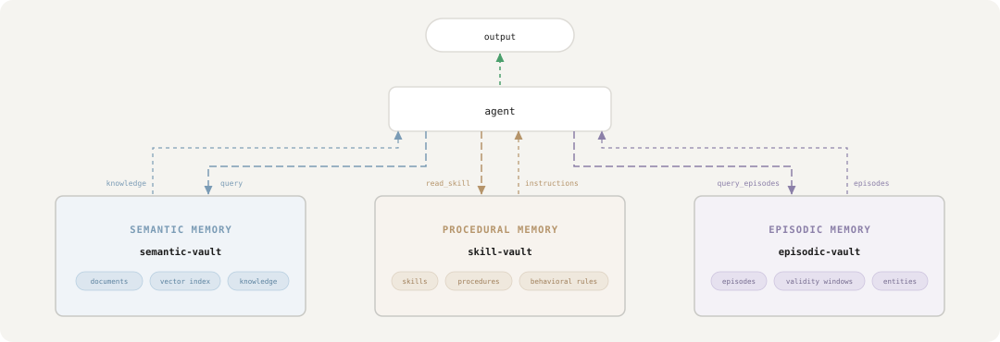

# Memory types

Classical cognitive architectures, from [ACT-R (Anderson et al., 2004)](https://en.wikipedia.org/wiki/ACT-R) to [CoALA (Sumers et al., 2024)](https://arxiv.org/abs/2309.02427), separate an agent's long-term memory into distinct modules: semantic memory for world knowledge, and procedural memory for skills and behavioral rules. Most agent frameworks ignore this distinction and store everything in a single vector index. CtxVault adds the third module an agent needs to stay coherent over time: episodic memory, for what happened and when.

In CtxVault, the separation is structural. A **semantic vault** holds documents, indexes them into a vector store, and supports retrieval by meaning: it is the agent's knowledge base. A **skill vault** holds natural-language procedures with explicit names and descriptions, the agent's behavioral repertoire. An **episodic vault** holds individual statements that have a lifetime: what happened, when, and whether it still holds. The agent queries the first to know *what*, reads the second to know *how*, and consults the third to know *when*.

All three vault types share the same infrastructure primitives: public or restricted, local or global, composable in any topology. The difference is what they store and how the agent uses it.



## Semantic vaults

A semantic vault is a directory of documents (`.pdf`, `.docx`, `.md`, `.txt`) and a local Chroma index next to them. `ctxvault index` extracts each document's text and cuts it into chunks in the vault's own embedding model's tokens, up to that model's input limit (254 tokens for the default model, with 15% of overlap between consecutive chunks), so every chunk is embedded whole. Markdown is chunked on its headings, and each section carries its heading path, so a chunk keeps the context it came from.

A query embeds the question with the same model and returns the closest chunks, each with its document, the metadata the writing agent attached, and a `similarity` in `[0, 1]`. Agents can write documents too: they are indexed the moment they are written.

The index can drift from the files: a document edited after indexing, or deleted. `ctxvault docs <vault> --status` says which documents are out of sync and which files were never indexed, and `ctxvault reindex <vault> --stale` brings the index back in line with the folder.

## Skill vaults

A skill vault holds procedures: natural-language instructions with an explicit name and description, the agent's behavioral repertoire. The agent lists the skills a vault offers, by name and description, and reads the one it needs. Nothing is embedded: a procedure is chosen by what it is for, not by similarity.

Skills are `.md` files with YAML frontmatter defining the skill's name and description, followed by the instructions in markdown. You can create them manually or let an agent write them via the API or MCP server.

```markdown
---
name: Weekly Engineering Update
description: How to write the weekly engineering status update for stakeholders
---

You are writing the weekly engineering update...

## Required structure
...

## Hard rules
- Never exceed 250 words.
- Never start with a greeting.
```

Drop the file into a skill vault and run `ctxvault index <vault>` and the skill is immediately available to any agent that queries the vault.

Any frontmatter field beyond `name` and `description` is kept as the skill's metadata.

## Episodic vaults

What persists for months rather than days also has to change. An episodic vault keeps that kind of memory: facts are superseded instead of overwritten, so a correction closes the old statement and opens the new one without losing either; a statement said better is revised, keeping what attested it; and retrieval returns what holds today unless asked for a past instant.

Episodic memory is the one an agent needs to stay coherent across sessions, and the one a vector index handles worst: similarity cannot tell a fact from the fact that replaced it. So episodes are stored **bi-temporally**: each one records the window in which it is true in the world (`valid_from` / `valid_to`) and when the vault recorded it and recorded its closing (`recorded_at` / `invalidated_at`). Correcting a statement closes the old one exactly where its successor opens, in a single transaction, and links the two. Nothing is deleted: `valid_at` reconstructs what was true at any past moment, `known_at` reconstructs what the agent had learned by then (an end learned later does not count yet, and an end is not a retraction: the statement stays true for its window), and the supersession chain explains how a belief got where it is. Hearing a statement again is neither a new episode nor a correction: confirming it keeps the one episode and records one more attestation, so a fact heard once can be told from one heard fifty times. And two statements that cannot both hold, when nobody can yet say which is wrong, are put in dispute rather than one of them being guessed away: both stay open and come back flagged with each other, until closing or superseding one settles it.

Retrieval in an episodic vault is structured first, by entity, validity and source, because that is what most questions to an episodic memory actually are. Semantic similarity is an optional second path that only switches on when the vault is created with an embedding model, so episodic memory costs nothing to anyone who does not want vectors.

From the CLI, an episodic vault is written one statement at a time and corrected as things change:

```bash
ctxvault init account-memory --type episodic

# Record a statement, open ended until something closes it
ctxvault write-episode account-memory "Sarah Klein is the main contact" -e "Sarah Klein" --salience 0.9

# What holds now
ctxvault episodes account-memory --entity "Sarah Klein"

# Correct it when reality changes, keeping both versions linked
ctxvault supersede account-memory <episode_id> "Marco Rossi is the main contact"

# What was true at a past instant, and how a statement changed
ctxvault episodes account-memory --valid-at 2026-04-10T00:00:00+00:00
ctxvault episode account-memory <episode_id> --history
```

Episodes live in a single SQLite file, `episodes.db`, in the vault's directory: there is nothing to index, and every change is a row, so the full history stays queryable.
