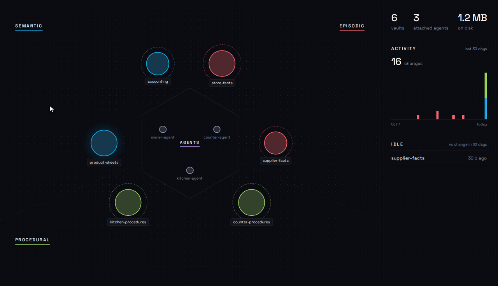
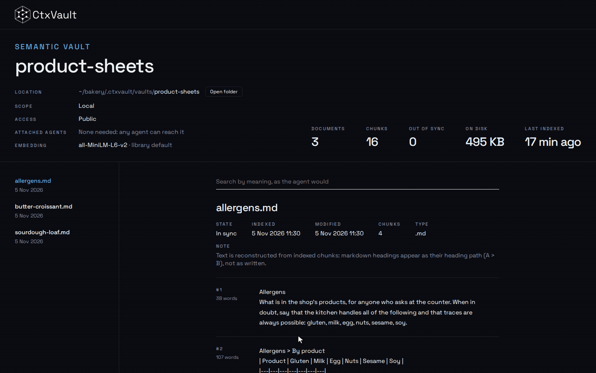
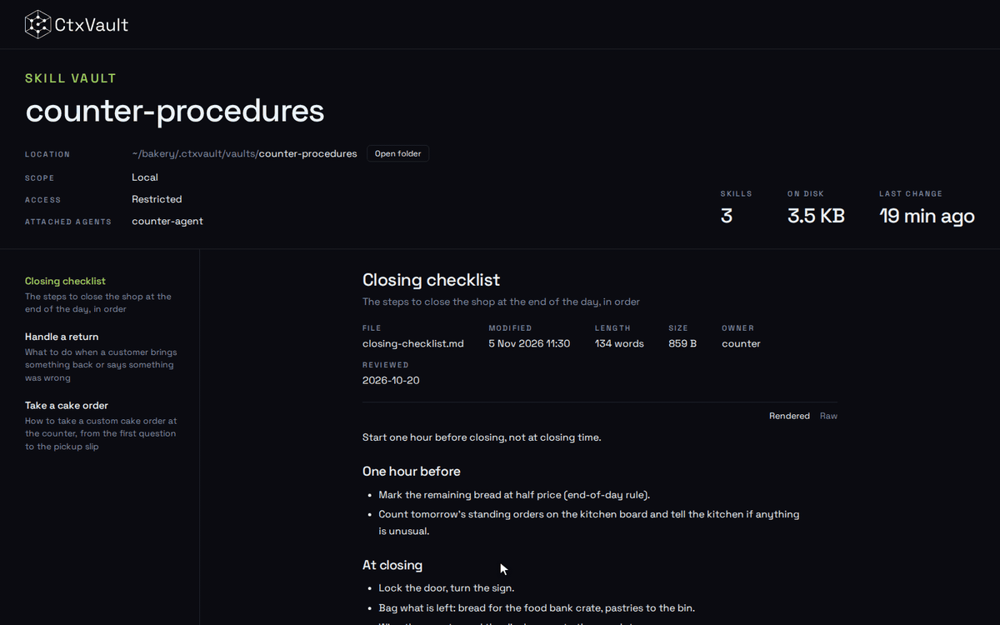
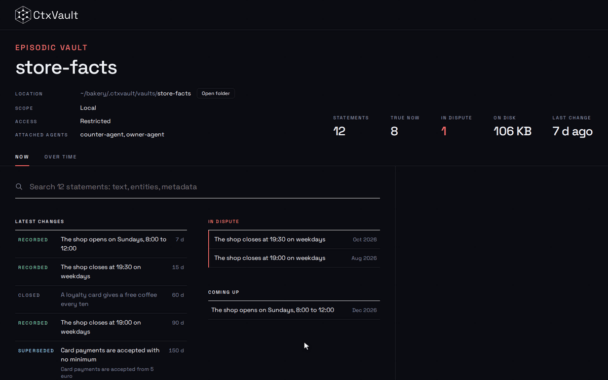
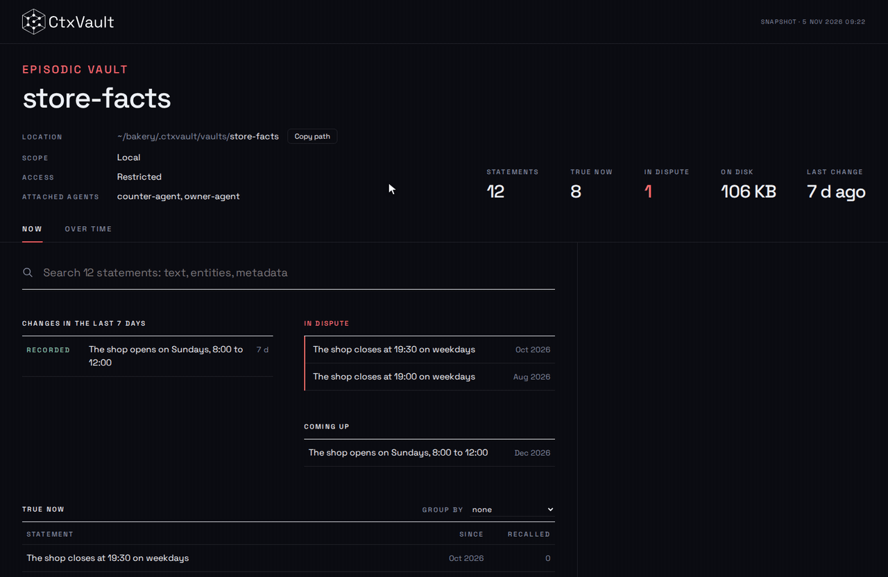

# Memory viewer

`ctxvault ui` is the memory, looked at. It opens a page in the browser that reads the same vaults as the CLI, through the same core, so it shows whatever was written through any interface: an agent over MCP, a pipeline over HTTP, you from the terminal. It is read-only and runs entirely on your machine.

```bash
ctxvault ui
```

To try it without installing anything, open the [live demo](demo.html): the bakery of [example 07](https://github.com/Filippo-Venturini/ctxvault/tree/main/examples/07-full-memory-topology), three agents, six vaults of every type, a year of facts.

## The map

The first page is the topology: every registered vault, placed in the sector of its type, and every agent attached to one, in the middle. Hover a vault to see its type, what it holds and which agents reach it; hover an agent to see every vault it can reach, public ones included. A public vault has a soft halo, a restricted one a dashed ring.



## Inside a vault

Every vault page starts with where it lives, its scope, who can reach it and its numbers. **Open folder** opens the vault's directory in your file manager: the page is a view of what is on disk, nothing more. Below the header, what the vault holds.

### Semantic

The documents, each with its state against the file on disk (in sync, changed since indexing, missing) and its chunks, whole, exactly as the agent receives them. Files in the folder that were never indexed are listed apart. On a live server, the search box queries the vault by meaning, as the agent would, and shows the similarity of each hit.



### Skill

The skills, each with its file, size, length and any extra frontmatter. The instructions are rendered from their markdown; **Raw** shows the file as written.



### Episodic

**Now** shows what holds today, the latest changes, the statements in dispute and the ones that become true later. Click a statement for its two timelines (in the world, in the memory), its versions, who confirmed it and what contradicts it.



**Over time** has a time cursor: drag it back and the page shows what the memory held on that day, what is new since, what has stopped being true and what was revised.



## Snapshots

```bash
ctxvault ui --export memory.html --note "What this is, for whoever opens it"
```

`--export` writes the page and a snapshot of every vault to one self-contained HTML file that opens without a server: to attach to an issue, archive a state, or publish a demo. The [live demo](demo.html) is such a snapshot. `--note` adds a line at the top of the page until it is dismissed.

## Who can open it

The viewer is the owner's view, like the CLI: it shows every vault, restricted ones included. `ctxvault ui` binds to `127.0.0.1` by default; binding anything else with `--host` exposes every vault to whoever can reach the port.

The viewer is also mounted at `/ui` on the HTTP API server, for whoever already runs one. There it answers only requests from the machine running the server, because the API may listen beyond localhost for agents, and the viewer is not gated by agent names.

See the [`ui` command](reference/cli.md#ui) for every option.
